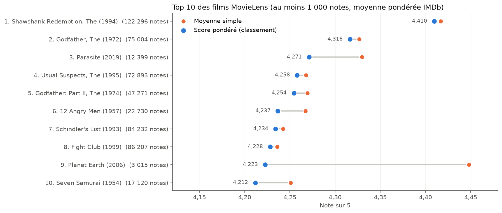
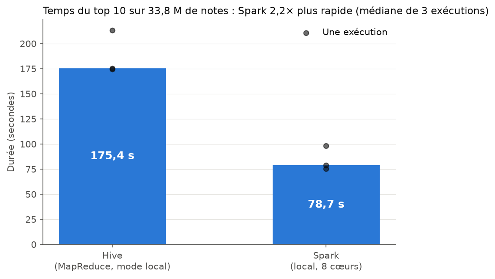
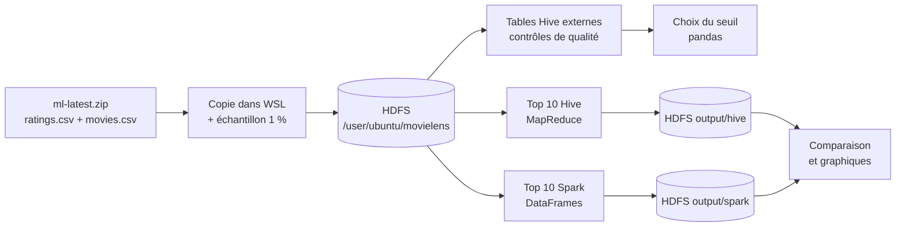

# Top 10 des films MovieLens avec Hive et Spark

Projet final du module **Introduction au Big Data & Écosystème Hadoop** (L3 Intelligence Artificielle, ISM Dakar, enseignant : M. Fall).

**Question traitée :** quels sont les 10 films les mieux notés du jeu de données MovieLens, avec un nombre minimal de notes pour que le classement soit crédible ?
Le top 10 est calculé deux fois, avec **Hive** puis avec **Spark (PySpark)**, et les deux outils sont comparés.

## Résultat

Films ayant **au moins 1 000 notes**, classés par **moyenne pondérée façon IMDb** :
score = (n × moyenne + m × C) / (n + m), avec n = nombre de notes du film, m = 1 000 et C = 3,5425 (moyenne de toutes les notes).

| Rang | Film | Notes | Moyenne simple | Score pondéré |
|---|---|---|---|---|
| 1 | The Shawshank Redemption (1994) | 122 296 | 4,4168 | **4,4097** |
| 2 | The Godfather (1972) | 75 004 | 4,3266 | **4,3163** |
| 3 | Parasite (2019) | 12 399 | 4,3299 | **4,2712** |
| 4 | The Usual Suspects (1995) | 72 893 | 4,2679 | **4,2580** |
| 5 | The Godfather: Part II (1974) | 47 271 | 4,2695 | **4,2544** |
| 6 | 12 Angry Men (1957) | 22 730 | 4,2672 | **4,2366** |
| 7 | Schindler's List (1993) | 84 232 | 4,2423 | **4,2341** |
| 8 | Fight Club (1999) | 86 207 | 4,2360 | **4,2281** |
| 9 | Planet Earth (2006) | 3 015 | 4,4481 | **4,2226** |
| 10 | Seven Samurai (1954) | 17 120 | 4,2508 | **4,2117** |



## Comparaison Hive / Spark

| Critère | Hive | Spark |
|---|---|---|
| Résultat | identique (mêmes films, même ordre, mêmes scores) | identique |
| Temps médian (3 exécutions, 33,8 M de notes) | 175,4 s | **78,7 s** (2,2 fois plus rapide) |
| Lignes de code utiles | **36** | 50 |

Spark est plus rapide car il garde les données en mémoire et calcule sur 8 tâches en parallèle, alors que Hive enchaîne plusieurs jobs MapReduce avec écriture sur disque entre chaque étape.
Limite : Hive tourne ici en mode local (sans YARN), ce qui le désavantage. Hive est plus court à écrire (SQL), Spark est plus souple (Python).



## Pipeline



1. **Données** : `ratings.csv` (33 832 162 notes) et `movies.csv` (86 537 films) de MovieLens `ml-latest`, copiés dans WSL puis chargés dans HDFS (7 blocs de 128 Mo).
2. **Qualité (Véracité)** : 0 valeur manquante, 0 note invalide, 0 doublon, 0 note sur un film inconnu. Les timestamps sont convertis en dates (de 1995 à 2023). Aucune correction n'a été nécessaire.
3. **Seuil** : la moitié des films ont 5 notes ou moins. Le seuil de 1 000 notes garde 4 464 films (5,4 %), qui représentent 89,7 % des notes, avec une incertitude d'environ ±0,03 étoile sur la moyenne.
4. **Top 10** avec Hive puis avec Spark, chacun lisant les données dans HDFS et y écrivant son résultat.
5. **Comparaison** (résultat, temps, lignes de code) et **graphiques**.

Le détail de chaque étape, des commandes et des problèmes rencontrés est dans [`docs/journal.md`](docs/journal.md).

## Environnement

Windows + WSL 2 (Ubuntu 24.04), 8 Go de RAM (5 Go pour WSL), 8 cœurs.
Java 11, Hadoop 3.3.6 (HDFS, réplication 1), Hive 3.1.3 (MapReduce en mode local, metastore Derby), PySpark 3.5.9 (mode local), Python 3.12 avec pandas et matplotlib.

## Organisation du dépôt

```
hive/        requêtes Hive : création des tables, qualité, stats par film, top 10
spark/       script PySpark du top 10
scripts/     préparation des données, chronométrages, comparaison
notebooks/   choix du seuil (04) et graphiques (08)
results/     résultats légers : top 10, temps, contrôles de qualité, comparaison
figures/     graphiques PNG
screenshots/ captures d'écran (HDFS, Hive, Spark, interface web)
docs/        journal de bord et diagnostic de l'environnement
data/        données locales (non versionnées)
```

## Relancer le projet

Toutes les commandes se lancent dans WSL, depuis la racine du dépôt.

```bash
# 0. Démarrer HDFS
start-dfs.sh && hdfs dfsadmin -safemode wait

# 1. Copier les données dans WSL, créer l'échantillon et charger dans HDFS
#    (adapter la variable SRC du script au dossier où ml-latest est décompressé)
bash scripts/02_preparer_donnees.sh

# 2. Tables Hive et contrôles de qualité
hive --hivevar db=movielens --hivevar dir=raw -f hive/01_creer_tables.hql
hive --hivevar db=movielens -f hive/02_qualite_notes.hql
hive --hivevar db=movielens -f hive/03_qualite_films_dates.hql

# 3. Statistiques par film pour le choix du seuil (puis notebooks/04_choix_seuil.ipynb)
hive --hivevar db=movielens -f hive/04_stats_par_film.hql > results/stats_par_film.tsv

# 4. Top 10 avec Hive, puis chronométrage
hive --hivevar db=movielens --hivevar seuil=1000 -f hive/05_top10_hive.hql
bash scripts/05_chrono_hive.sh 3

# 5. Top 10 avec Spark, puis chronométrage
spark-submit --master "local[*]" --driver-memory 2g spark/top10_spark.py --dir raw --seuil 1000
bash scripts/06_chrono_spark.sh 3

# 6. Comparaison (puis notebooks/08_visualisation.ipynb pour les graphiques)
python3 scripts/07_comparaison.py
```

Pour un test rapide sur l'échantillon (1 % des notes) : `db=movielens_sample`, `dir=sample` et un seuil de 10.

## Données

MovieLens `ml-latest` (GroupLens, Université du Minnesota) : https://grouplens.org/datasets/movielens/
Les fichiers de données ne sont pas inclus dans ce dépôt : ils sont trop volumineux pour GitHub (ratings.csv fait 891 Mo), et la licence MovieLens n'autorise pas leur redistribution sans l'accord de GroupLens.

## Auteurs

Groupe ISM, L3 IA, 2026 :
- Hamze Abdoulkarim Aden : pipeline, code, analyse, rapport
- À COMPLÉTER : vidéo de
